<p align="center">
  <picture>
    <source media="(prefers-color-scheme: dark)" srcset="assets/banner-dark.png">
    
  </picture>
</p>

<div align="center">

# vscode-sfl

**Language support for SFL diagrams in VS Code.**

</div>

SFL is the text format behind [StickyFlow](https://github.com/Stickyflow)
diagrams. This extension makes `.sfl` files feel like any other language in
your editor: highlighting, errors as you type, completion, hover docs,
go-to-definition, rename and formatting. It covers SFL 1.6, the same grammar
[`stickyflow.js`](https://github.com/Stickyflow/stickyflow.js) renders.

Want to see the diagram too? Installing this extension also installs its
companion, [`vscode-sfl-preview`](https://github.com/Stickyflow/vscode-sfl-preview),
which renders a live preview next to the editor.

## Why vscode-sfl?

An SFL diagram is just text, so it lives next to your code: it diffs,
reviews and version-controls like everything else in the repo. But a text
format is only pleasant to write if the editor understands it. Without
language support, a typo in a `from:` target or a misspelled style name
only shows up when the diagram renders wrong.

With it, you get the feedback loop you already expect from a real language.
Rename a block and every link pointing at it follows. Hover a style and see
the properties it inherits. Ctrl+click a link endpoint and land on the
shape it connects to.

```sfl
sfl 1.6

Style Pill {
  shape: pill
  fill: "#d9ff00"
}

Model checkout {
  Shape add_products : Pill {
    kind: process
    text: "Add products"
  }

  Shape pay : Pill {
    kind: process
    text: "Pay"
  }

  Link add_to_pay {
    from: add_products
    to: pay
  }
}
```

## Not just diagrams

The same language draws buildings, posters, patterns and interface screens.
Every piece below is a short file in [`examples/creative/`](examples/creative).
Click one to read its source. Open it in VS Code and everything above
applies: hover a style to see what it sets, rename a block with F2, and
with the preview to the side, watch the piece redraw as you type.

### Architecture in isometric

Eight buildings, each in a palette of its own. `Isometric` blocks are the
walls, roofs and floors. A `Symbol` outline extruded by its height makes
the eight-sided lighthouse and minarets, and `shape: sphere` the domes and
palm crowns. The repeated parts are SFL 1.6 `Repeat` blocks: the balconies
of the brutalist block, the lit windows of the night towers, the stair of
the ziggurat. The toy city is one `Template` placed in every cell of a
`Repeat` with a random height and color.

<table>
  <tr>
    <td align="center" width="25%">
      <a href="examples/creative/brutalist-block.sfl">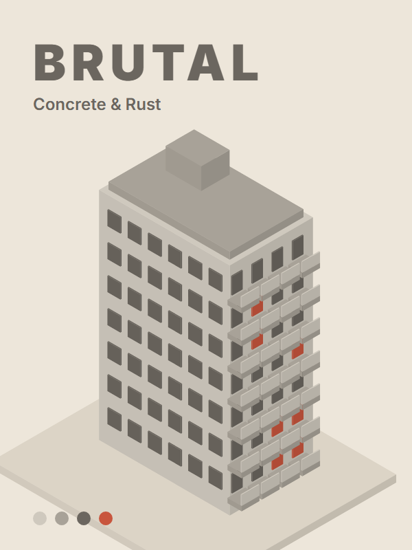</a><br>
      <sub><b>Brutalist Block</b> · Concrete & Rust</sub>
    </td>
    <td align="center" width="25%">
      <a href="examples/creative/canal-houses.sfl">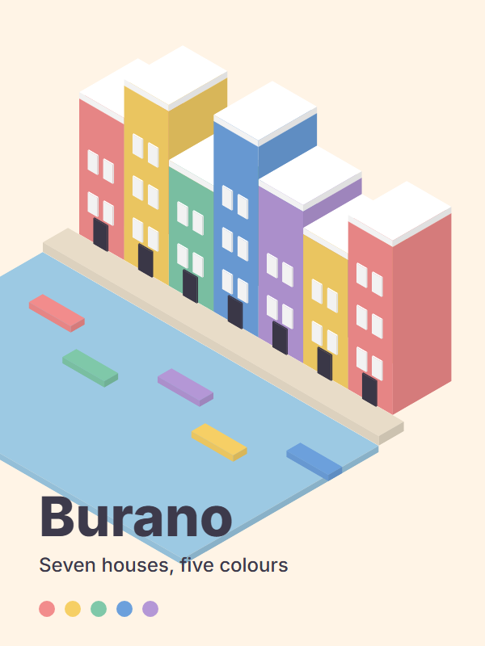</a><br>
      <sub><b>Canal Houses</b> · Burano</sub>
    </td>
    <td align="center" width="25%">
      <a href="examples/creative/desert-villa.sfl">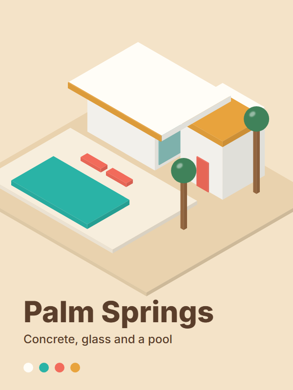</a><br>
      <sub><b>Desert Villa</b> · Palm Springs</sub>
    </td>
    <td align="center" width="25%">
      <a href="examples/creative/night-towers.sfl">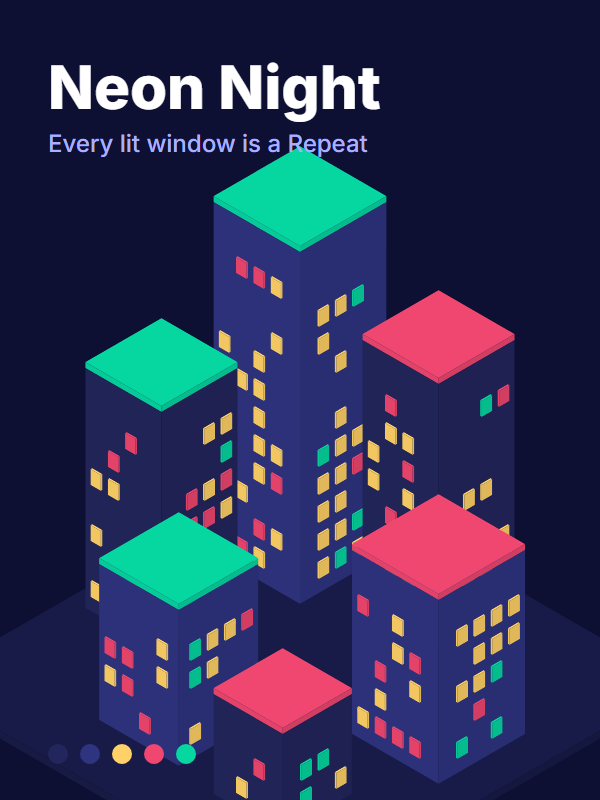</a><br>
      <sub><b>Night Towers</b> · Neon Night</sub>
    </td>
  </tr>
  <tr>
    <td align="center" width="25%">
      <a href="examples/creative/lighthouse.sfl">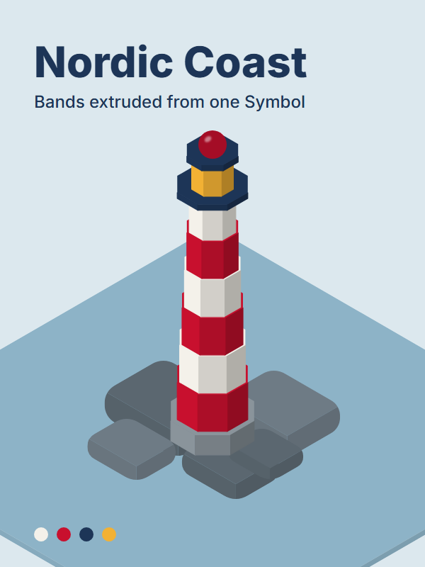</a><br>
      <sub><b>Lighthouse</b> · Nordic Coast</sub>
    </td>
    <td align="center" width="25%">
      <a href="examples/creative/ziggurat.sfl">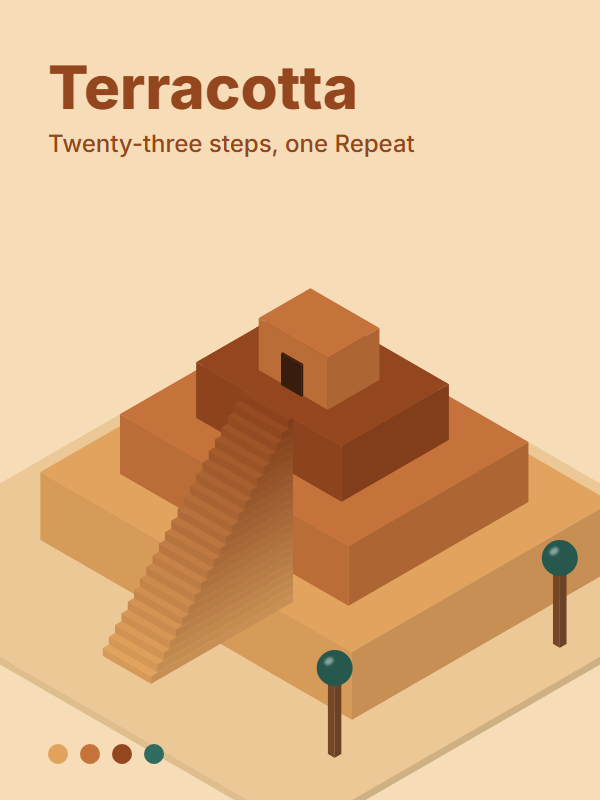</a><br>
      <sub><b>Ziggurat</b> · Terracotta</sub>
    </td>
    <td align="center" width="25%">
      <a href="examples/creative/pavilion.sfl">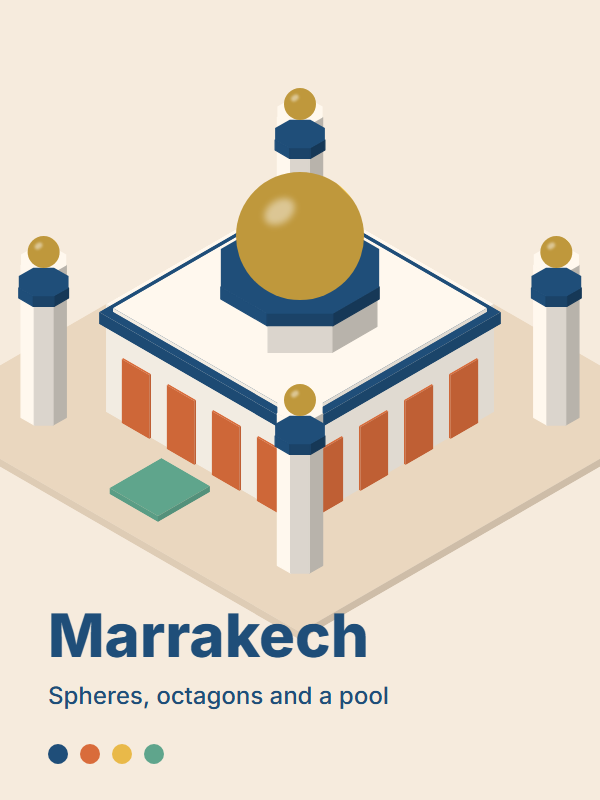</a><br>
      <sub><b>Pavilion</b> · Marrakech</sub>
    </td>
    <td align="center" width="25%">
      <a href="examples/creative/toy-city.sfl">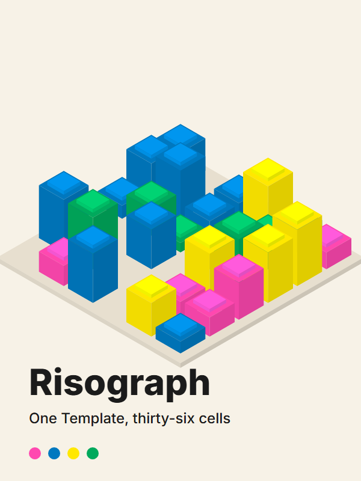</a><br>
      <sub><b>Toy City</b> · Risograph</sub>
    </td>
  </tr>
</table>

### From the Creative Work page

Posters, patterns, an interface screen and an isometric scene from the
[Creative Work](https://stickyflow.org/creative-work) page of StickyFlow.

<table>
  <tr>
    <td align="center" width="25%">
      <a href="examples/creative/bauhaus-study.sfl">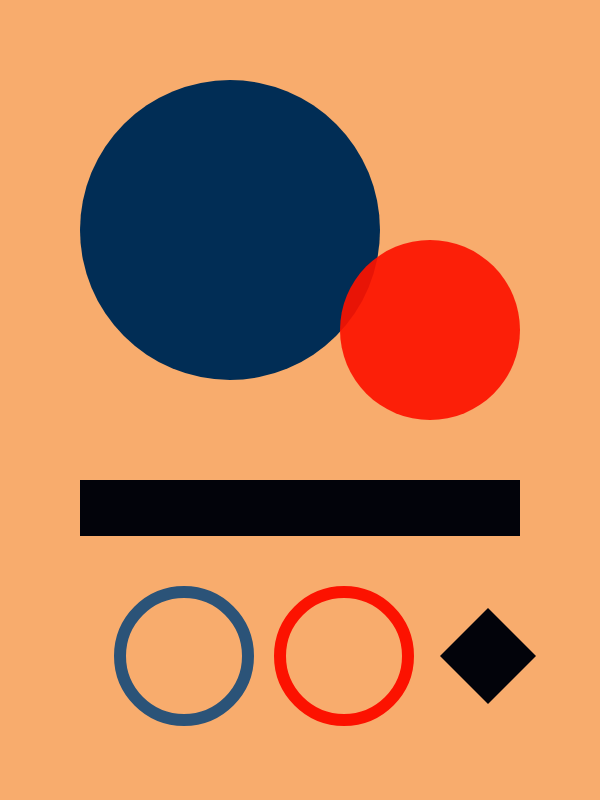</a><br>
      <sub><b>Bauhaus study</b> · Shapes</sub>
    </td>
    <td align="center" width="25%">
      <a href="examples/creative/after-hours.sfl">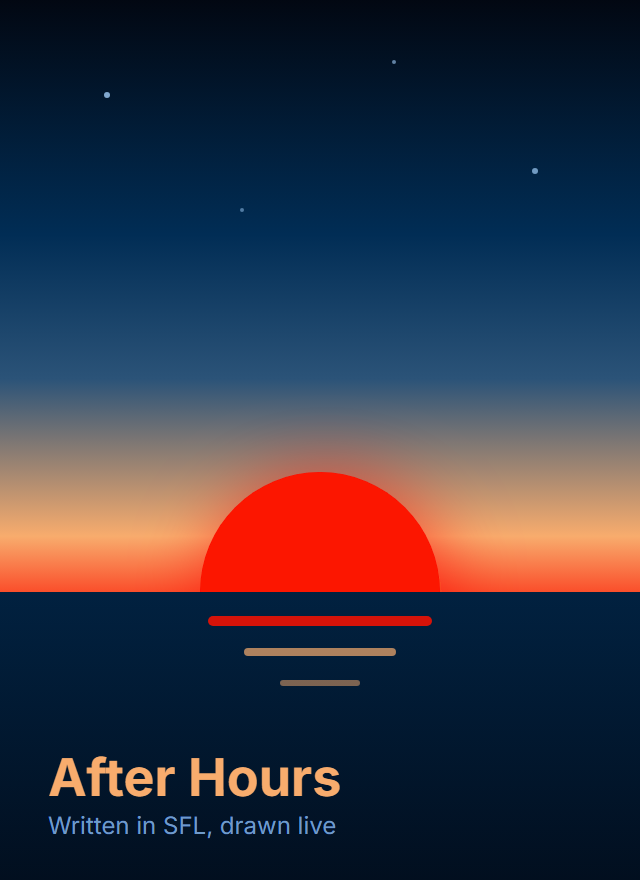</a><br>
      <sub><b>After Hours</b> · Poster</sub>
    </td>
    <td align="center" width="25%">
      <a href="examples/creative/three-towers.sfl">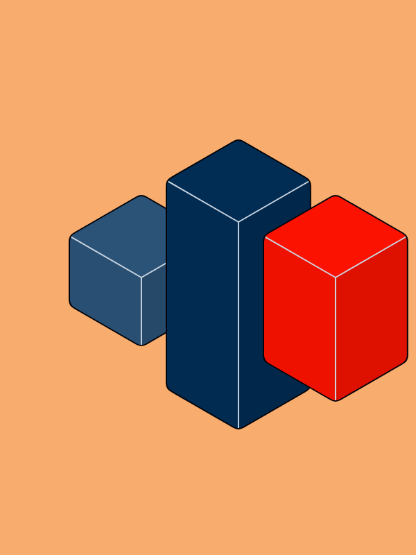</a><br>
      <sub><b>Three towers</b> · Isometric</sub>
    </td>
    <td align="center" width="25%">
      <a href="examples/creative/swiss-type.sfl">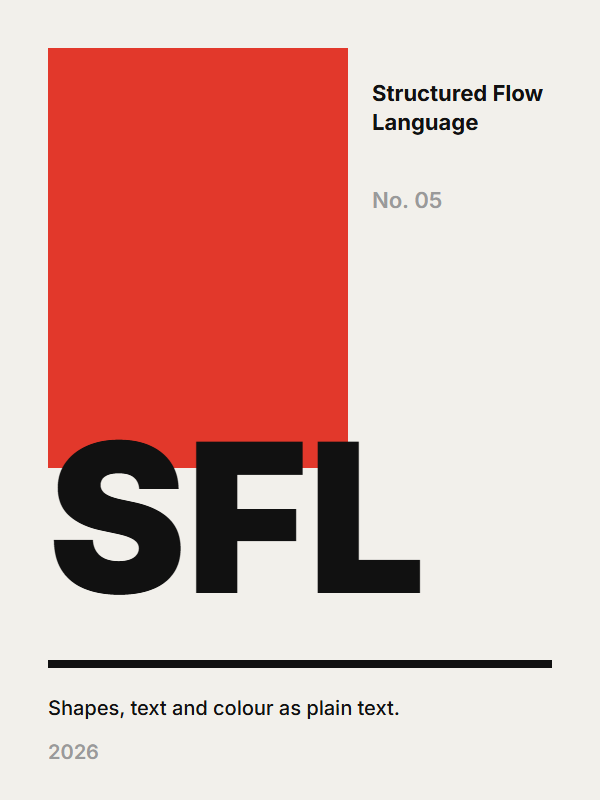</a><br>
      <sub><b>Swiss Type</b> · Type poster</sub>
    </td>
  </tr>
  <tr>
    <td align="center" width="25%">
      <a href="examples/creative/golden-hour.sfl">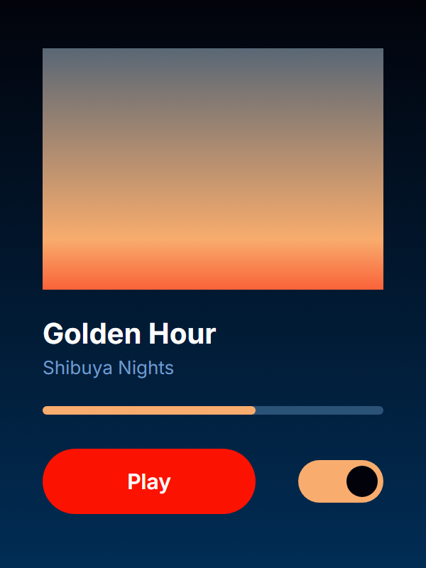</a><br>
      <sub><b>Golden Hour</b> · Interface</sub>
    </td>
    <td align="center" width="25%">
      <a href="examples/creative/dawn-hills.sfl">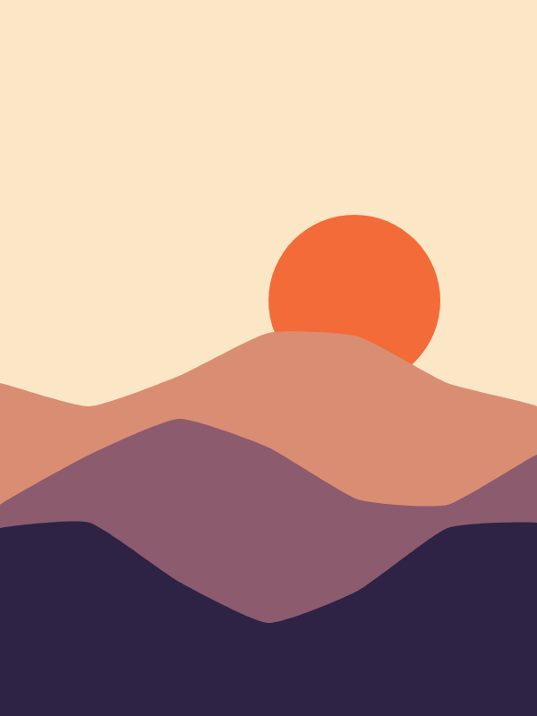</a><br>
      <sub><b>Dawn Hills</b> · Landscape</sub>
    </td>
    <td align="center" width="25%">
      <a href="examples/creative/3am.sfl">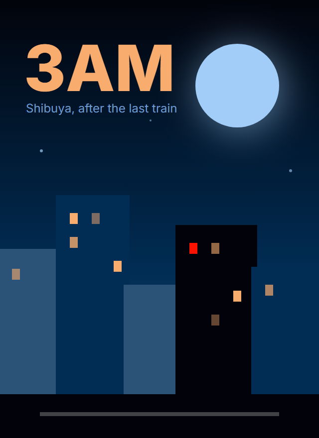</a><br>
      <sub><b>3AM</b> · Poster</sub>
    </td>
    <td align="center" width="25%">
      <a href="examples/creative/rings.sfl">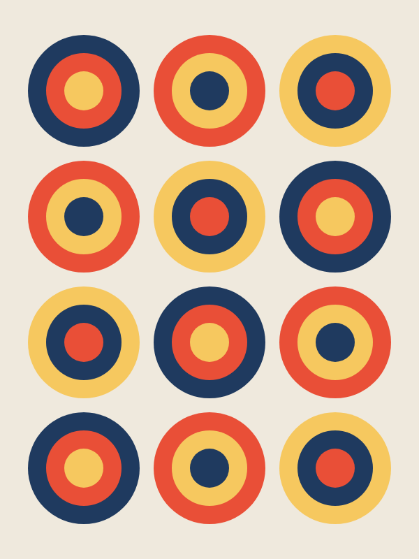</a><br>
      <sub><b>Rings</b> · Pattern</sub>
    </td>
  </tr>
  <tr>
    <td align="center" width="25%">
      <a href="examples/creative/fire-hydrant.sfl">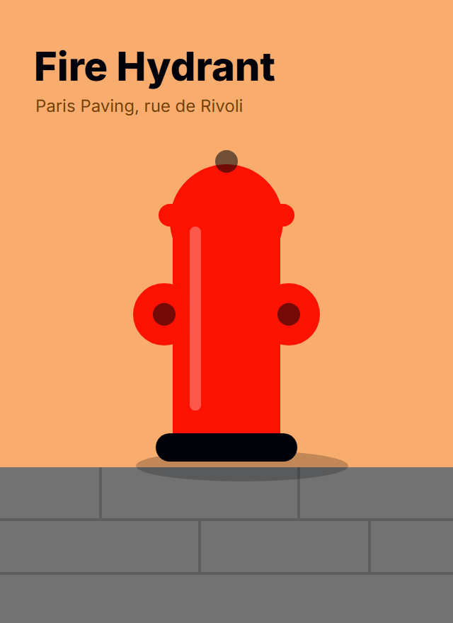</a><br>
      <sub><b>Fire Hydrant</b> · Poster</sub>
    </td>
    <td align="center" width="25%">
      <a href="examples/creative/repeat-pattern.sfl">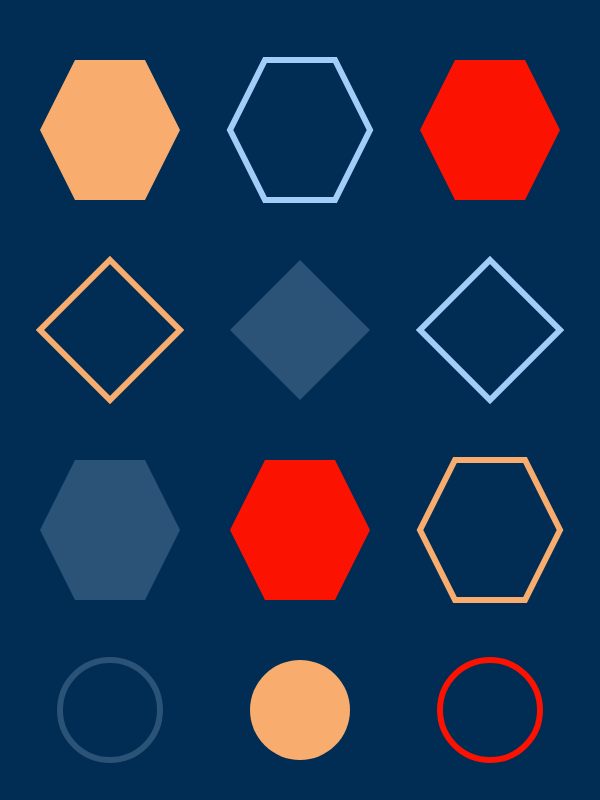</a><br>
      <sub><b>Repeat pattern</b> · Pattern</sub>
    </td>
    <td align="center" width="25%">
      <a href="examples/creative/eclipse.sfl">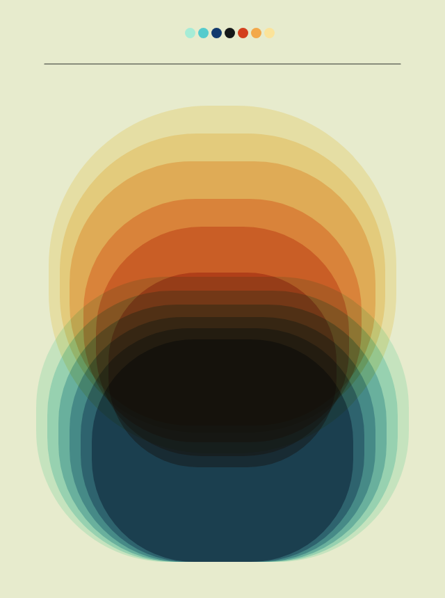</a><br>
      <sub><b>Eclipse</b> · Layered glass</sub>
    </td>
    <td align="center" width="25%">
      <a href="examples/creative/dusk.sfl">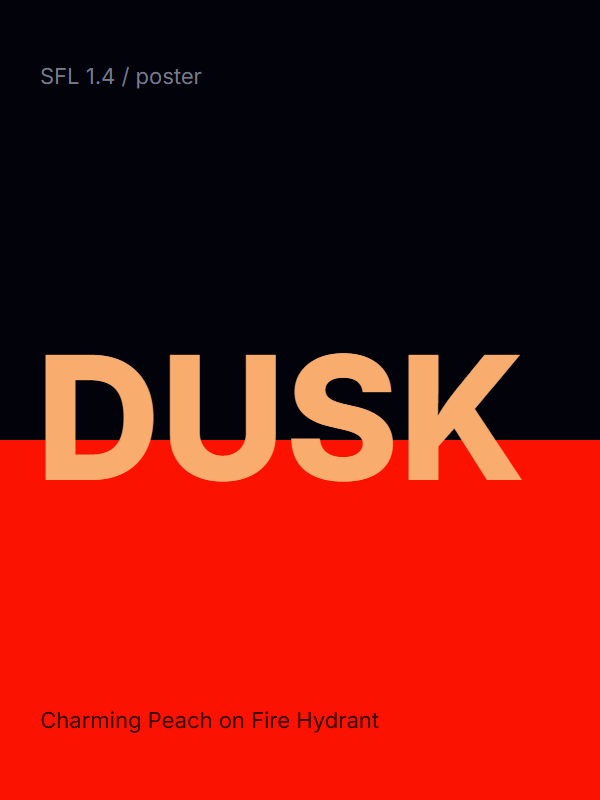</a><br>
      <sub><b>Dusk</b> · Type poster</sub>
    </td>
  </tr>
</table>

## Features

- **Syntax highlighting** for block headers, composition lists
  (`: Style & Style`), `layout {}` / `style {}` sub-blocks, strings
  (including `"""…"""`), numbers, property keys and comments.
- **Diagnostics**: parse errors, `from:`/`to:` targets that don't exist,
  unknown style or layout references, duplicate names, inheritance cycles.
- **Completion** for block keywords, property keys, fixed values (`kind`,
  `shape`, `route`, …), style and layout names after `:` or `&`, and the
  names of your own entities inside `from:`/`to:`.
- **Hover docs** for keywords, properties and their accepted values, plus a
  style's effective (inherited) properties.
- **Go to Definition** (Ctrl/Cmd+click), **Find All References**
  (Shift+F12) and **Rename** (F2), which updates the declaration and every
  reference in one edit and refuses name collisions.
- **Outline** and breadcrumbs showing the block tree.
- **Format Document** (Shift+Alt+F), skipped when the file has syntax
  errors so a broken line is never silently dropped.
- **Style templates**: *SFL: Apply Style Template* restyles the whole file
  in one undoable edit. Pick Night Lime, Midnight Violet, Graphite Mono,
  Paper Navy, Charcoal Pastel, Evergreen Ledger, Neon Dispatch, Calm Sage,
  Ember Noir, Studio Light, Violet Circuit, Deep Sea, Prism, Indigo Wire, Poolside or Mint Lemonade (with the SFL Preview open, the highlighted
  one shows there live before you pick); the template's Style blocks (`tpl_*`) are
  written into the file, so the look travels with it to every renderer.
  Start nodes (`kind: start`, or where a flow begins) and `kind: highlight`
  shapes (e.g. the main path through a flow) get the accent style.
  Every template turns a decision's links labelled yes or no ("Sí", "No",
  ...) into small branch circles (`kind: yes` / `kind: no`). End nodes
  (`kind: end`) get the accent inverted, and notes (`kind: note`) are
  muted and dashed so they don't read as a step of the flow. Charcoal
  Pastel also colors `kind: decision`, `kind: input` and `kind: output`.
  Shapes like a decision diamond are kept. Once a file has a template, the
  picker's last entry, **None**, removes it again (its `tpl_*` Styles and
  every reference to them). A block with its own Style gets a derived
  template Style that remembers it (`: ClientN` becomes `: tpl_node__ClientN`,
  with `Style tpl_node__ClientN : tpl_node { }`), so **None** brings its old
  look back. Local overrides the template
  removed (`style { fill: ... }` on a block) and the yes/no branch nodes it
  added stay as they are; Ctrl+Z undoes those too.
- The StickyFlow logo as the file icon for `.sfl` files, on top of whatever
  file icon theme you use (see [Notes](#notes)).

Syntax errors come from the parser in [stickyflow.js](https://www.npmjs.com/package/stickyflow),
the same one the renderer and the StickyFlow-Web Playground use, so VS Code
accepts exactly what renders. Format Document uses its `canonicalize()`.

All block kinds of stickyflow.js 0.3 are supported: the chart kinds
(`Chart`, `Axis`, `Series`, `Rule`, and series in `data { }`), `Path`,
`Symbol` / `Port`, `Net`, the isometric kinds `Isometric` and `Connection`,
`Text`, `Widget`, `Shader` and `DataSource`, plus bindings (`value: <- expr`)
and handlers (`onTap: target <- expr`). `Table` and its `Columns` / `Rows` /
`Footer` blocks were removed from stickyflow.js and are reported as errors.

## Installation

Install **StickyFlow SFL** from the
[VS Code Marketplace](https://marketplace.visualstudio.com/items?itemName=StickyFlowLab.vscode-sfl), or from inside VS Code:

1. Open the Extensions view (Ctrl/Cmd+Shift+X).
2. Search for **StickyFlow SFL**.
3. Click **Install**.

This also installs [StickyFlow SFL Preview](https://marketplace.visualstudio.com/items?itemName=StickyFlowLab.vscode-sfl-preview)
for live diagram rendering. Open any `.sfl` file and the language server
starts automatically.

To build and install from source instead:

```bash
npm install
npm run package          # produces vscode-sfl-<version>.vsix
code --install-extension vscode-sfl-<version>.vsix
```

## Development

```bash
npm install
npm run compile          # or `npm run watch`
```

Open this folder in VS Code and press **F5**. That launches an Extension
Development Host with the language server attached; the **Attach to
Server** config lets breakpoints in `src/server/**` hit.

The `fixtures/valid/` folder is a good playground. `checkout-flow.sfl`
exercises most features: try F2 on `load_cart`, hover `FilledPill`,
Ctrl+click a `from:` target or Shift+F12 on `BasePill`.

### Tests

```bash
npm test                   # unit tests (vitest), no VS Code needed
npm run test:integration   # launches a real VS Code with the extension
```

Unit tests round-trip every fixture through the parser and cover each
language feature directly. Integration tests check what unit tests can't:
that the extension activates and the client actually talks to the server.

If integration tests fail when run from a terminal inside VS Code (or an
AI assistant's sandbox), run them from a plain terminal instead. A leaked
`ELECTRON_RUN_AS_NODE=1` or a Windows installer mutex are the usual
culprits.

## Notes

- **The parser is a copy.** `src/server/sfl-core/` is a ported copy of the
  SFL parser, extended to track source ranges, so the extension stays
  self-contained. When the SFL grammar changes, port the change here too:
  nothing keeps the copies in sync automatically.
- **Colors are fixed to a dark palette.** Highlighting colors are pinned to
  match the StickyFlow editor, regardless of your VS Code theme. They look
  best on dark themes.
- **The `.sfl` icon is a language icon, not an icon theme.** It shows up as
  soon as the extension is installed and leaves every other icon alone. VS
  Code only uses it where your file icon theme has no icon of its own for
  `.sfl` files, so a theme that ships one wins.

## 🙌 Contributing

The extension is small and self-contained, which makes it a good place to
start. Two goals behind that:

- 🌱 **Grow it.** Semantic tokens, light-theme colors, quick fixes for
  common diagnostics, whatever's missing from your workflow: PRs are
  welcome.
- 🛠️ **Make it yours.** Each language feature lives in its own file under
  `src/server/features/`, so a focused change doesn't require understanding
  the whole server first.

See [Development](#development) to get set up. Found a bug or have an idea?
Open an issue or send a PR: small and focused beats big and perfect. We'll
review, comment if needed, and merge when we're happy with it. 🚀
